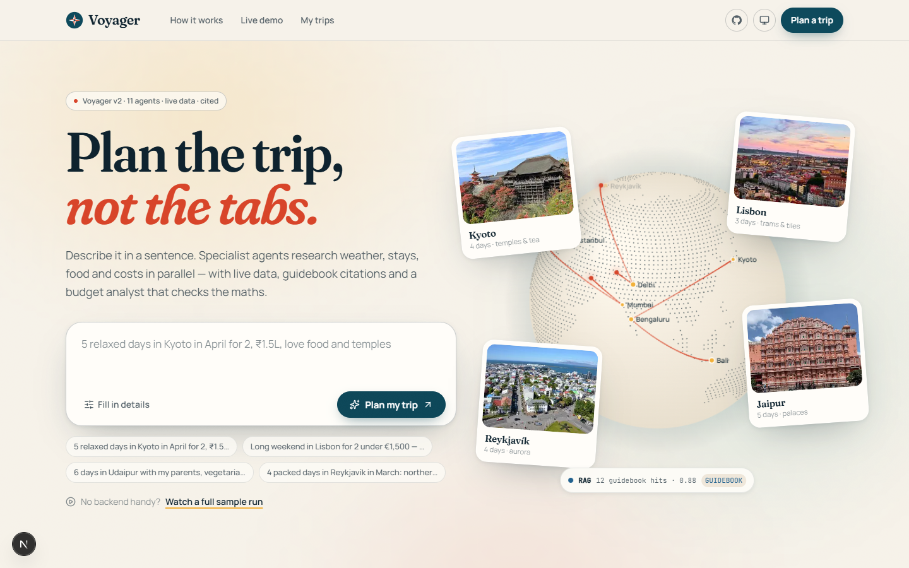
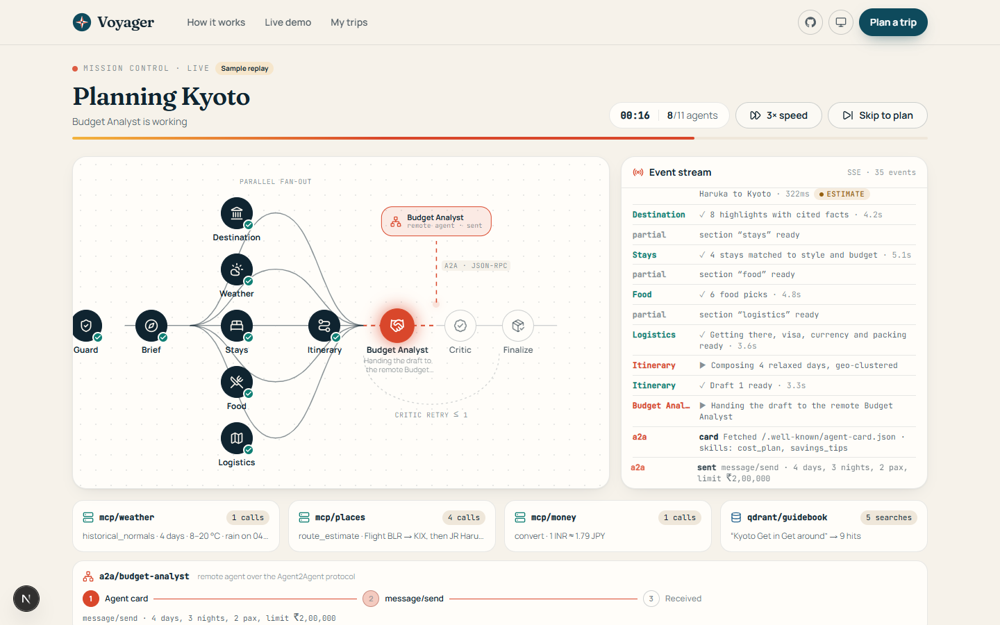
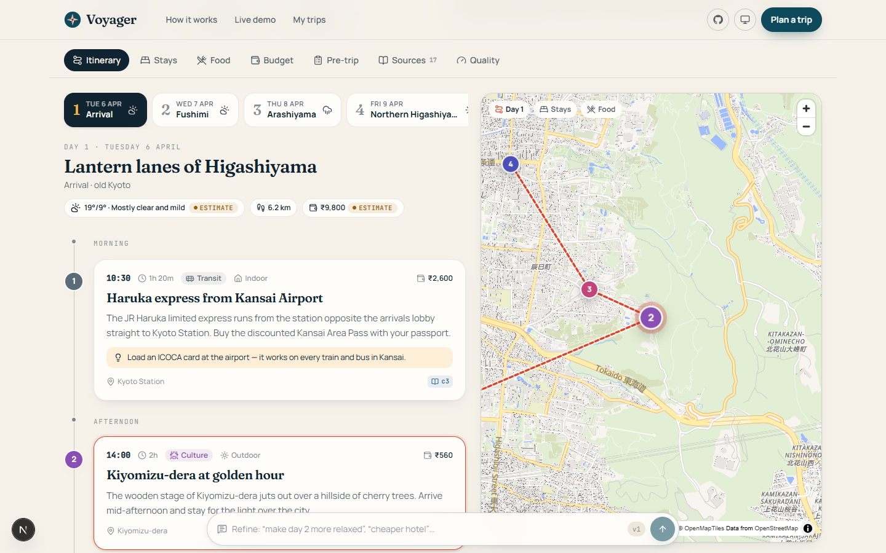
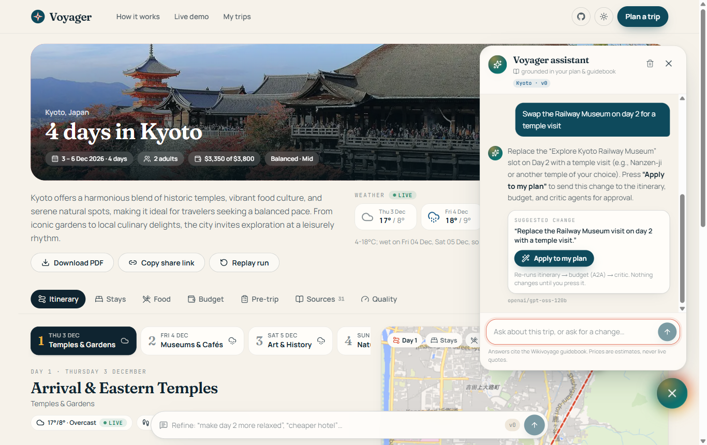
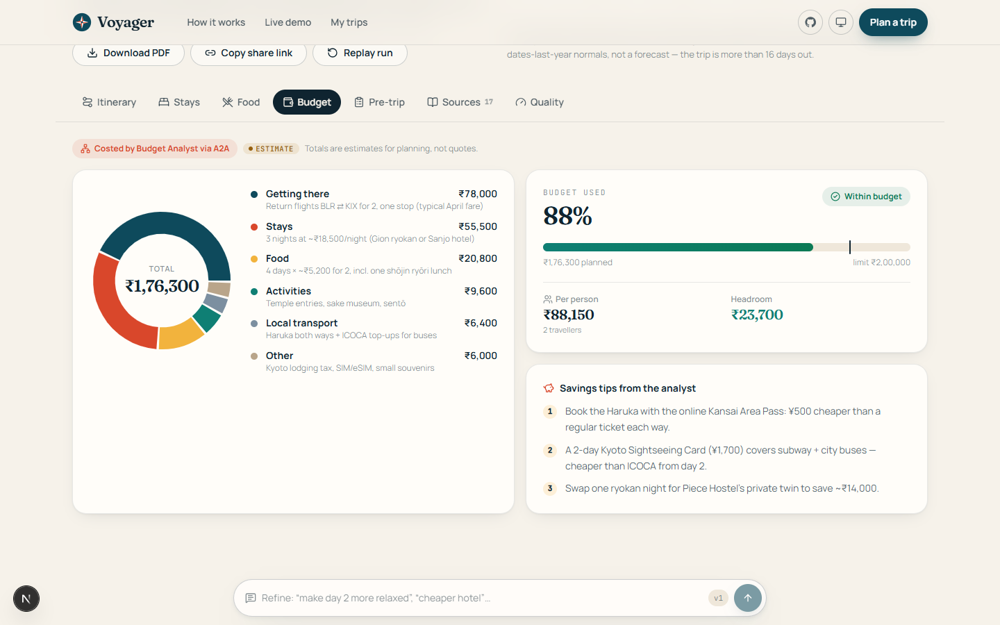
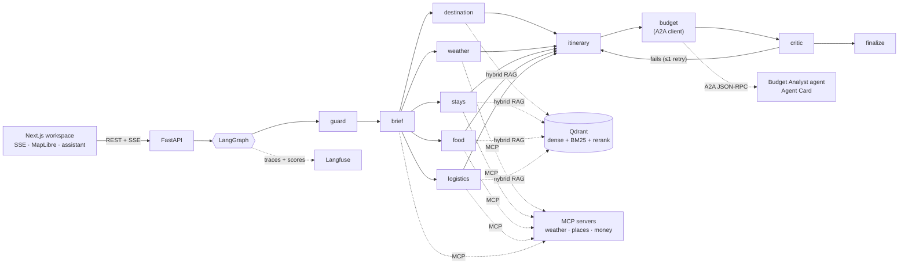

# Voyager: a multi-agent AI travel planner

**[▶ Try it live](https://voyager-travel-planner-green.vercel.app)** · [watch a recorded run](https://voyager-travel-planner-green.vercel.app/trip/demo) · API: [`/health/ready`](https://voyager-api-ujao.onrender.com/health/ready)

> Free hosting: the API sleeps when idle, so the first plan of the day waits ~1 minute while it wakes up (the page shows this). A plan then takes ~30–90 s on the free 0.1-CPU instance.

Describe a trip in one sentence. A team of AI agents researches it in parallel using **live data
from MCP tool servers** and a **Qdrant hybrid-RAG guidebook**. A separate **Budget Analyst agent,
called over the A2A protocol**, costs the plan, and a critic checks it before you see it. The result
is a day-by-day itinerary with a map, stays, food, budget, a pre-trip checklist, sources and quality
scores, streamed live into a Next.js workspace. You can refine it by chat or ask the built-in
assistant about it.



| Mission control (agents working live) | Trip workspace (itinerary + map) |
|---|---|
|  |  |
| **AI assistant (grounded in the plan, can propose a change)** | **Budget costed by the A2A agent** |
|  |  |

## What makes it different

- **11 agents, 5 running in parallel.** A LangGraph graph fans out to destination, weather, stays,
  food and logistics specialists at the same time. A 4-day plan takes **~33 s** end to end, compared
  with 3–5 minutes for the sequential v1.
- **Live data, clearly labelled.** Three MCP servers (weather, places, money) wrap free live APIs:
  Open-Meteo, OpenStreetMap and Frankfurter exchange rates. Every hotel, restaurant, forecast and
  price is tagged `live`, `guidebook`, `estimate`, `cached` or `unavailable`. Estimates are never
  shown as live.
- **Agent-to-agent costing.** The Budget Analyst is an independent A2A service with an Agent Card
  (`/.well-known/agent-card.json`) and JSON-RPC. The planner discovers it and sends it the draft
  plan. If the analyst is unreachable, a labelled local fallback takes over.
- **A guidebook that grows itself.** 9,026 Wikivoyage passages for 65 cities sit in Qdrant with dense
  (bge-small) and sparse (BM25) vectors, RRF fusion, a cross-encoder re-ranker and a destination
  pre-filter. If you ask for a city it doesn't know, it fetches, embeds and indexes that city on the
  spot (Hoi An: 72 passages in 11.3 s).
- **Famous sights first.** Relevance search has no idea what's famous. Voyager ranks a city's
  guidebook listings by how often the rest of the guide refers to them, so Jaipur's plan opens with
  Amber Fort and City Palace, not a random garden.
- **Grounded and checked.** Every activity cites a guidebook passage or an OpenStreetMap record. A
  critic agent checks day count, dates, budget fit, citation coverage, wrong-city leakage and
  geography, and sends the itinerary back once if anything fails.
- **Human in the loop.** "Make day 2 more relaxed" re-runs only itinerary → budget → critic from the
  saved checkpoint. A floating AI assistant answers questions about your plan and can turn a request
  into a refinement.
- **Production behaviour.** Guardrails screen inputs (prompt injection, PII redaction, scope, date
  and budget sanity). Requests are rate-limited per IP. The LLM gateway uses structured output with
  JSON repair and a token budget per model. When a model's daily quota runs out it switches to the
  next model instead of failing. An identical request is answered from a plan cache (0.7 s).

## Architecture



| Layer | Choice |
|---|---|
| Orchestration | LangGraph `StateGraph`, parallel fan-out, SQLite checkpointer (resumable refinements) |
| LLMs | Groq `openai/gpt-oss-120b` (itinerary, critic), `openai/gpt-oss-20b` (specialists), automatic fallback chain |
| Tools | MCP (`mcp` FastMCP) servers over stdio / streamable HTTP, per-agent tool allow-lists |
| Agent-to-agent | `a2a-sdk` server + client, Agent Card discovery |
| RAG | Qdrant (embedded or server), fastembed `BAAI/bge-small-en-v1.5` + `Qdrant/bm25`, RRF, MiniLM cross-encoder |
| Backend | FastAPI, SSE (replay + `Last-Event-ID` resume), SQLAlchemy, Pydantic v2 |
| Observability | Langfuse v5: one trace per trip with agent, LLM, tool and retriever spans, plus 6 quality scores |
| Evaluation | Ragas, a retrieval benchmark, deterministic checks, online scores on every run |
| Frontend | Next.js 16, React 19, TypeScript, Tailwind CSS v4, Motion, MapLibre GL, Recharts |
| Ops | Docker, docker-compose, GitHub Actions CI, Render (API) + Vercel (web) |

## Measured results

All numbers come from runs against the real stack. Details are in
[`docs/eval-results.md`](docs/eval-results.md).

| | Result |
|---|---|
| End-to-end plan, 4 days, Kyoto | **32.7 s** (v1: 3–5 min) |
| Repeat of the same trip | **0.7 s** (plan cache) |
| Uncovered city (Hoi An) incl. on-demand indexing | 57.6 s, of which 72 passages indexed in 11.3 s |
| Retrieval MRR@10, 20 labelled queries | BM25 0.85 → dense 0.97 → **hybrid + rerank 1.00** |
| Wrong-city passages in the top 5 | **0%** with the destination pre-filter (2% without it) |
| Golden set (10 trips): day count, dates, geography, wrong-city, injection, PII checks | **100%** |
| Citation coverage (online score, mean) | 0.96 |
| Offline test suite | 90 tests, no network (`VOYAGER_OFFLINE=1`) |

What still needs work: Ragas faithfulness is **0.26**. The itinerary text still adds the model's
general knowledge about famous places beyond what the cited passages say. The planned fix is more
evidence per place and stricter claim checking, and is written up in the eval report.

## Run it locally

```bash
# API (Python 3.11, uv)
cd apps/api
cp .env.example .env                              # add GROQ_API_KEY (Langfuse keys optional)
uv sync --extra eval
uv run python -m voyager.rag.ingest --warm        # one-time: download models + index the guidebook
PORT=8000 uv run uvicorn voyager.main:app --port 8000

# Web
cd apps/web
npm install
NEXT_PUBLIC_API_URL=http://localhost:8000 npm run dev   # http://localhost:3000
```

With no backend running, `/trip/demo` replays a real recorded run.

Useful commands:

```bash
VOYAGER_OFFLINE=1 uv run pytest -q                       # offline test suite
uv run python -m voyager.eval.run                        # Ragas + retrieval + checks → docs/eval-results.md
uv run python -m voyager.a2a.budget_server --port 9101   # run the A2A agent standalone
uv run python -m voyager.mcp.servers.weather --transport streamable-http   # any MCP server standalone
```

## Repository

```
apps/api/voyager/   graph/ (agents) · mcp/ (3 servers + hub) · a2a/ (Budget Analyst) · rag/ (Qdrant)
                    guardrails/ · llm/ (gateway) · memory/ · observability/ · eval/ · api/ · services/
apps/web/           app/ (pages) · components/ (landing, composer, trip workspace, assistant) · lib/
data/corpus.jsonl   Wikivoyage guidebook (CC BY-SA)
docs/               SPEC.md (API contract) · eval-results.md · sample-plan.json · screenshots/
```

v1 (the Streamlit version) is preserved at tag [`v1-streamlit`](../../tree/v1-streamlit).

## Author

**Pavani B**, AI Engineer:
[LinkedIn](https://linkedin.com/in/pavani-buchipalli-aba64b2b1) ·
[GitHub](https://github.com/pavanipavani16423-ctrl)

Guidebook text: Wikivoyage contributors, CC BY-SA 4.0. Map data: © OpenStreetMap contributors.
